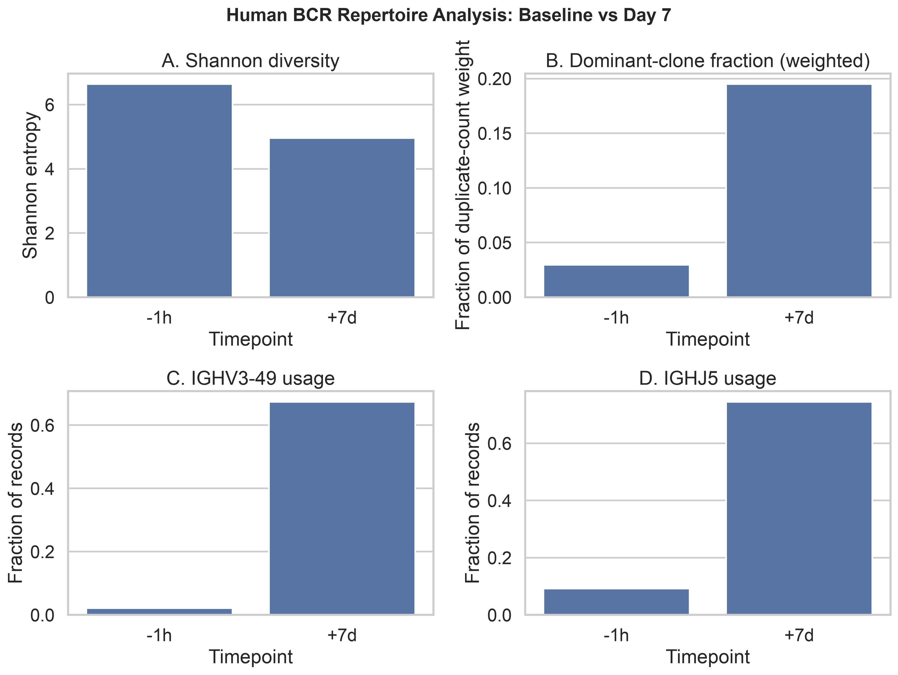
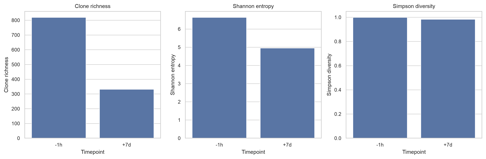
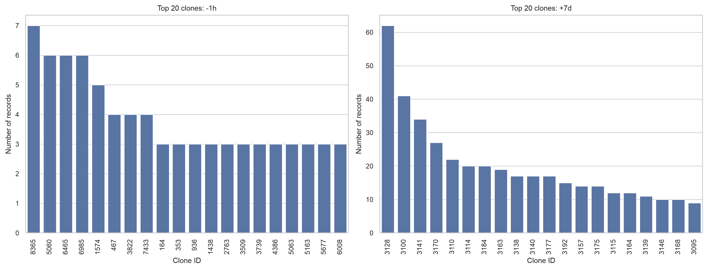
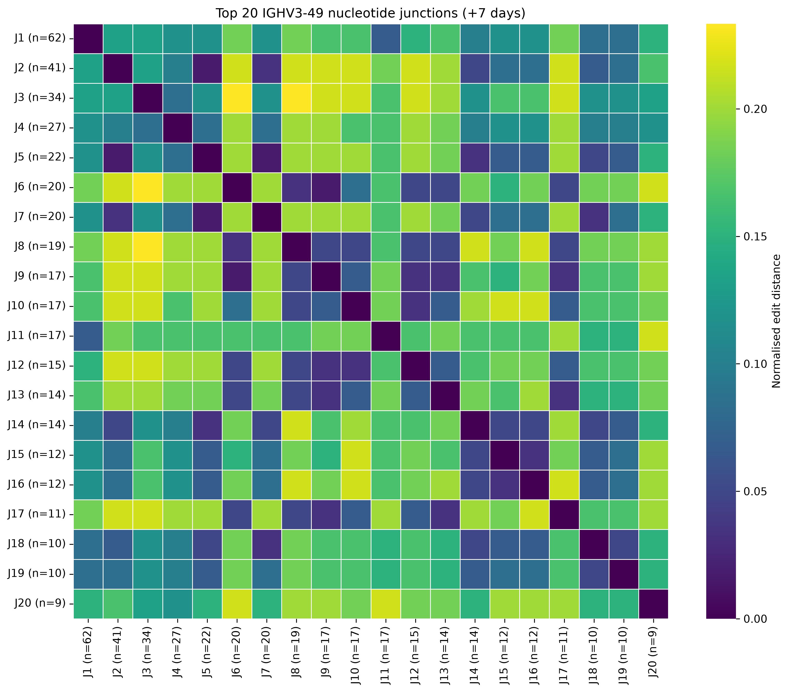

# Human B-Cell Receptor Repertoire Analysis

**An exploratory immunogenetics and B-cell clonality analysis using publicly available AIRR-formatted repertoire data**

## Project Overview

This project investigates changes in human immunoglobulin heavy-chain (IGH) repertoire composition between two sampling timepoints (−1 hour and +7 days) using processed B-cell receptor sequencing annotations.

The analysis examines repertoire diversity, clonotype abundance, IGHV/IGHJ gene usage, nucleotide junction similarity and the effect of sampling depth on diversity estimates.

The project demonstrates computational approaches relevant to immunogenetics, immune repertoire profiling and the investigation of clonal B-cell populations.

## Research Objectives

- Assess the quality and completeness of annotated IGH repertoire records.
- Characterise clonotype richness and diversity at two timepoints.
- Compare record-based and `duplicate_count`-weighted clonotype abundance.
- Examine IGHV and IGHJ gene usage.
- Investigate sequence similarity among abundant nucleotide junctions.
- Evaluate the influence of unequal record counts using rarefaction.

## Dataset

**Source:** Public processed BCR repertoire dataset distributed through OmicVerse.

**Download:** https://github.com/omicverse/omicverse-data/releases/download/airr-v1/bcr_repertoire.tsv.gz

**Format:** GZIP-compressed, tab-separated AIRR-style annotations.

The analysed subset contains 1,999 IGH records across two sampling timepoints.

| Timepoint | Initial records | Productive records |
|---|---:|---:|
| −1 hour | 1,000 | 937 |
| +7 days | 999 | 843 |
| **Total** | **1,999** | **1,780** |

The dataset contains V/D/J gene annotations, nucleotide junctions, clone identifiers, constant-region annotations and duplicate-count information.

The `junction_aa` field is entirely missing; therefore, amino-acid CDR3 analysis was not performed.

**Dataset SHA-256:**

`9d2c7bec0582b6912c0d6ed690563a5e07b3fd151a5e3ebb2628a998666622d5`

The original study attribution and redistribution permissions require independent verification before the raw dataset is redistributed.

## Methods

### 1. Quality Control

Records were filtered to retain productive IGH sequences with non-missing nucleotide junctions and clone identifiers and consistent junction-length annotations.

A total of 1,780 records passed these criteria.

### 2. Clonotype Diversity

Clonotype distributions were characterised using:

- Clone richness
- Shannon entropy
- Simpson diversity (1 − Σp²)
- Largest-clone fraction

Both record-based and duplicate-count-weighted metrics were calculated.

### 3. Immunoglobulin Gene Usage

IGHV and IGHJ assignments were extracted from the annotated repertoire data.

Relative gene frequencies were calculated independently for each timepoint.

### 4. Rarefaction

The repertoires were compared at a common depth of 843 records using 1,000 random subsampling iterations with a fixed random seed.

### 5. Nucleotide Junction Similarity

The 20 most frequent IGHV3-49-associated nucleotide junctions at +7 days were compared using normalised global edit distances.

These distances describe sequence similarity and are not interpreted as definitive evidence of shared B-cell lineage.

## Results

### Repertoire Diversity

| Metric | −1 hour | +7 days |
|---|---:|---:|
| Productive records | 937 | 843 |
| Distinct clone IDs | 819 | 332 |
| Shannon entropy | 6.6358 | 4.9557 |
| Simpson diversity | 0.9985 | 0.9828 |
| Largest-clone fraction | 0.75% | 7.35% |

The +7-day repertoire exhibited lower observed diversity and greater concentration of annotated records among fewer clonotypes.

### Duplicate-Count-Weighted Analysis

| Metric | −1 hour | +7 days |
|---|---:|---:|
| Sum of duplicate counts | 1,244 | 2,904 |
| Weighted Shannon entropy | 6.3403 | 3.8111 |
| Weighted Simpson diversity | 0.9963 | 0.9366 |
| Weighted largest-clone fraction | 2.97% | 19.49% |

Abundance weighting increased the apparent concentration of the +7-day repertoire.

### Equal-Depth Comparison

At a common depth of 843 records:

| Metric | −1 hour | +7 days |
|---|---:|---:|
| Mean clone richness | 744.09 | 332.00 |
| Mean Shannon entropy | 6.5463 | 4.9557 |
| Mean Simpson diversity | 0.9984 | 0.9828 |

The observed diversity difference persisted after controlling for the modest difference in record counts.

### IGHV/IGHJ Gene Usage

At +7 days:

- IGHV3-49 represented 67.38% of productive records.
- IGHJ5 represented 74.50%.
- The IGHV3-49/IGHJ5 combination occurred in 558 records.
- IGHV3-49-associated records contained 100 distinct nucleotide junctions.

These observations indicate a concentrated gene-usage profile, but high gene frequency alone does not establish monoclonality.

### Junction Similarity

Among the 20 most frequent IGHV3-49-associated nucleotide junctions:

| Metric | Normalised distance |
|---|---:|
| Mean | 0.1404 |
| Minimum | 0.0167 |
| Maximum | 0.2333 |

Some abundant junction sequences were closely similar, although lineage relationships were not established.

## Key Visualisations

### Integrated Repertoire Summary



### Repertoire Diversity



### Clonotype Abundance



### Nucleotide Junction Similarity



Additional IGHV/IGHJ gene-usage figures and clone-size distributions are available in `figures/`.

## Reproducibility

**Language:** Python

**Libraries:** pandas, NumPy, SciPy, Matplotlib, Seaborn and Biopython.

Create a virtual environment and install dependencies:

```bash
python3 -m venv .venv
source .venv/bin/activate
python -m pip install -r requirements.txt
```

Download the dataset:

```bash
mkdir -p data/raw data/processed results figures

curl -fL \
  "https://github.com/omicverse/omicverse-data/releases/download/airr-v1/bcr_repertoire.tsv.gz" \
  -o data/raw/bcr_repertoire.tsv.gz
```

Run the analysis scripts in numerical order from the project root directory:

```bash
for script in scripts/[0-9][0-9]_*.py; do
    python "$script"
done
```

The pipeline produces processed records, CSV summaries and publication-style figures.

## Limitations

- This is a small, processed public repertoire subset rather than a complete raw-sequencing study.
- The two timepoints do not provide independent biological replication.
- The meaning and experimental provenance of `duplicate_count` require confirmation from the original dataset documentation.
- Record abundance cannot automatically be equated with independent B-cell counts.
- Gene usage and junction similarity do not independently establish shared clonal ancestry.
- Rarefaction controls observed record depth but not all sequencing or sampling biases.
- No clinical MBL samples, flow-cytometry measurements or diagnostic reference standards were analysed.
- No diagnostic sensitivity, specificity or clinical validation claims are made.

## Relevance to Molecular Immunogenetics

This project demonstrates computational skills in immune repertoire quality control, immunoglobulin gene annotation, clonotype analysis, diversity estimation, sequence comparison and reproducible bioinformatics workflows.

These approaches provide a foundation for future work investigating B-cell clonality and integrating repertoire sequencing with orthogonal molecular or cellular measurements.

## Author

Janhavi Vanjari  
MSc Bioinformatics — Ghent University  
BTech Bioengineering — Vellore Institute of Technology